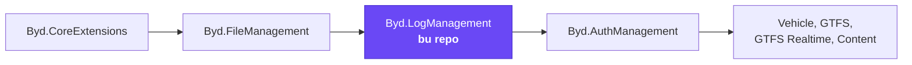
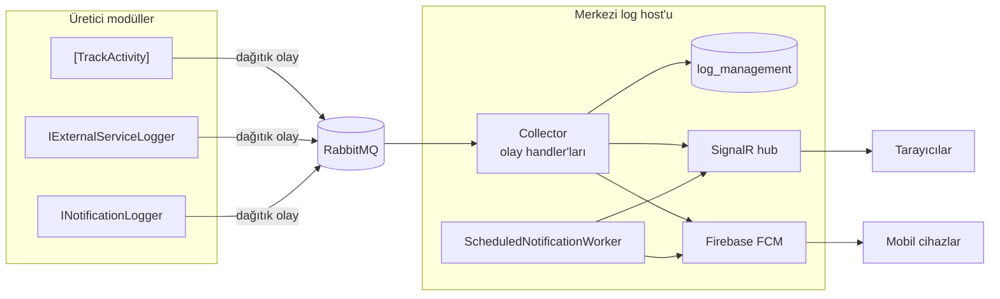
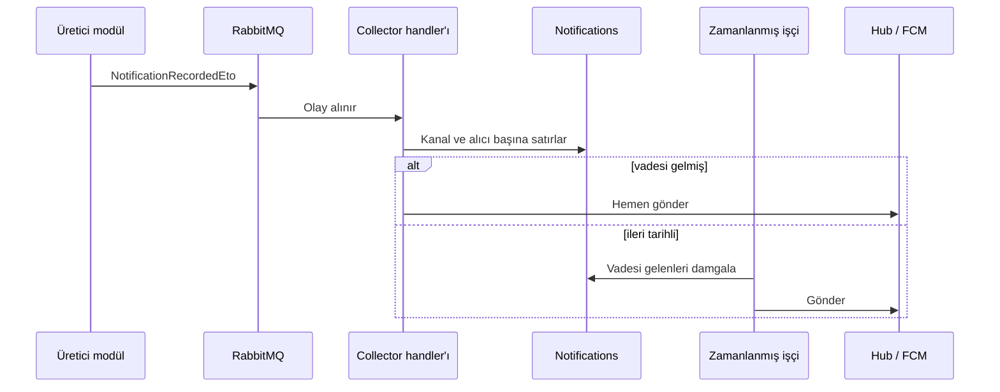
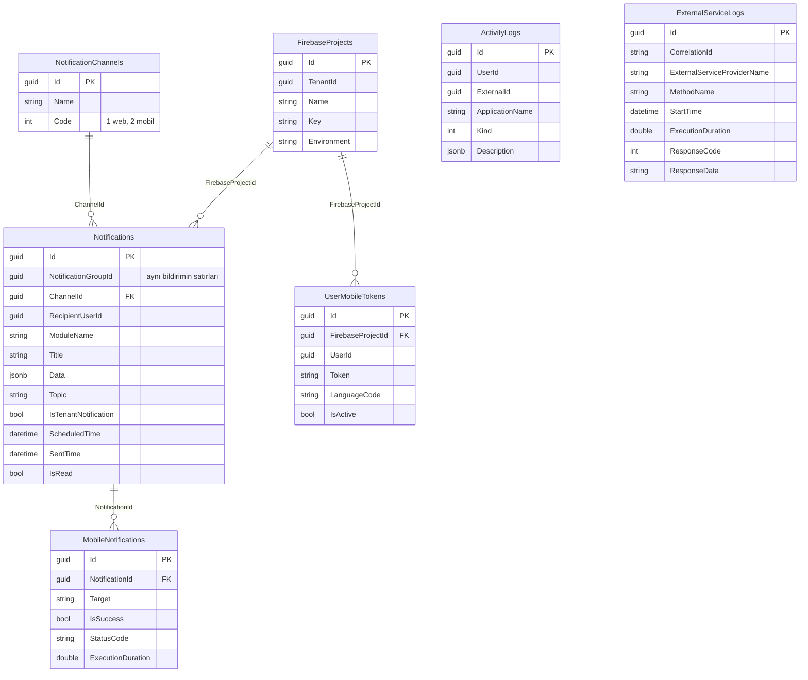

# Byd.LogManagement

[](https://www.nuget.org/packages/Byd.LogManagement.Domain)


Platformda "ne oldu" sorusunun tek sahibi. İstek ve audit kayıtlarını, kullanıcı etkinlik izini, dış servis çağrılarını
tutar; web ve mobil bildirim gönderir, bağlı ekranlara canlı veri akıtır. Bir modül kendi log tablosunu ya da kendi push
entegrasyonunu yazmaz: niyetini bildirir, log modülü kaydeder ve teslim eder.

## İçindekiler

- [Platformdaki yeri](#platformdaki-yeri)
- [Bir bakışta](#bir-bakışta)
- [Üretici ve merkez](#üretici-ve-merkez)
- [Özellikler](#özellikler)
- [HTTP uçları ve hub](#http-uçları-ve-hub)
- [Olaylar](#olaylar)
- [Veritabanı](#veritabanı)
- [Yetkiler](#yetkiler)
- [Ayarlar](#ayarlar)
- [Hata kodları](#hata-kodları)
- [Bir modülde kullanmak](#bir-modülde-kullanmak)
- [Geliştirme](#geliştirme)

## Platformdaki yeri



## Bir bakışta

| | |
|---|---|
| Paket ailesi | `Byd.LogManagement.*` |
| Sürüm | `0.1.7` (`common.props`) |
| Bağımlılık | `Byd.CoreExtensions` 0.3.11, `Byd.FileManagement` 0.1.5 |
| Veritabanı | PostgreSQL, `log_management` şeması (ABP audit tabloları da burada); bağlantı dizesi `Default` |
| Olay taşıyıcı | RabbitMQ |
| Canlı bağlantı | SignalR hub'ı, WebSocket ve SSE |
| Mobil push | Firebase Cloud Messaging (FCM) |

## Üretici ve merkez

Modül iki rolle kullanılır. Kayıt üreten her modül (üretici) yalnız sözleşmeleri alır ve kayıtlarını dağıtık olay olarak
gönderir. Olayları tüketen, tabloya yazan, bildirimi gönderen ve hub'ı açan taraf yalnız merkezi log host'udur; bu
parçalar `Byd.LogManagement.Collector` paketindedir.



Collector paketini üretici bir modüle eklemek her üreticinin her olaya abone olmasına yol açar; bu yüzden yalnız merkezi
host ekler.

## Özellikler

### 1. Etkinlik izi

Controller action'ına `[TrackActivity<TResource>(anahtar, tür, ...alanlar)]` yazılır. Action başarıyla bitince kayıt
merkeze gider. Metin üretici modülün kendi yerelleştirme dosyasındadır: `{0}` işlemi yapan kullanıcı, `{1}` ve sonrası
attribute'ta adı verilen DTO alanlarıdır. Değerler action'ın döndürdüğü kayıttan okunur; gövde dönmeyen action'da
(silme gibi) aynı adlı action girdisinden gelir.

| Tür | Anlamı |
|---|---|
| `Created` | Kayıt oluşturuldu |
| `Updated` | Kayıt güncellendi |
| `Deleted` | Kayıt silindi |
| `Uploaded` | Dosya yüklendi |
| `Downloaded` | Dosya indirildi |
| `StatusChanged` | Durum değişti |

### 2. Dış servis çağrı kaydı

`IExternalServiceLogger.TrackAsync(çağrı, iş)` bir HTTP ya da SDK çağrısını çalıştırır, süresini ve ham yanıtını kaydeder,
hata varsa özgün hatayı dokunmadan yeniden fırlatır. Kayıt çağrının yapıldığı tenant ve organizasyonu (kimlik ve ad) ve
isteğin correlation kimliğini taşır. Aynı isteğin bütün dış çağrıları correlation kimliğiyle tek seferde okunur.

Arka plan işçisi çağrıdan önce kapsamı değiştirmelidir; kayıt kapsamı çağrı anındaki `ICurrentTenant` ve
`ICurrentOrganization`'dan alır.

### 3. Bildirimler

Tek giriş noktası `INotificationLogger.NotifyAsync(NotificationRecord)`'dur. Bildirim kalıcıdır: giden kutu, gelen kutu ve
`Notifications` satırı sayesinde kaybolmaz.

| Alan | Ne söyler |
|---|---|
| `ChannelCodes` | Kanallar: `1` web, `2` mobil |
| `Title`, `Data` | Başlık ve içerik sözlüğü |
| `Recipients` | Alıcı kullanıcılar |
| `IsTenantNotification` | Kapsamdaki herkese gider: organizasyonda oluştuysa organizasyona, değilse tenant'a; alıcı listesine bakılmaz |
| `ScheduledTime` | En erken gönderim anı; boşsa hemen kuyruğa girer |
| `FirebaseProjectKey` | Mobil kanal istendiyse hangi Firebase projesiyle gideceği |
| `Topic` | Verildiyse mobil bildirim alıcılara değil topic üyelerine gider |
| `ExternalId` | Bildirimin dokunduğu iş kaydı |



Kullanıcı kendi bildirimlerini `notifications/my` ile okur ve okundu işaretler.

### 4. Canlı veri akışı

`INotificationLogger.StreamAsync(ad, veri)` bir organizasyonun bağlı ekranlarına anlık veri gönderir (araç konumu,
tahminler, pano akışı). Bilerek kalıcı değildir: giden kutu kullanılmaz, satır yazılmaz. Kaçan mesajın yerini bir
sonraki alır.

### 5. Gerçek zamanlı hub

Hub `/signalr-hubs/log-management/notifications` adresindedir ve WebSocket ile SSE üzerinden bağlanır; long polling
bilerek kapalıdır. Tarayıcı bu taşımalarda başlık gönderemediği için access token `access_token` sorgu parametresiyle
gelir.

| Mesaj | İçerik |
|---|---|
| `notificationReceived` | Kullanıcıya gelen bildirim |
| `streamReceived` | `{ moduleName, name, payload }`; `payload` JSON metni |

### 6. Mobil push

Firebase projeleri tenant başına tanımlanır; her projenin FCM servis hesabı dosyası file modülü üzerinden saklanır, repoya
girmez. Cihaz `mobile-tokens` ile kaydolur: kullanıcı başına, proje başına tek etkin token ve cihaz dili.

### 7. Audit kayıtları

ABP'nin audit tabloları `abp` yerine modülün kendi şemasına (`log_management`) taşınmıştır. Kaydın nereye yazılacağı
`LogManagement.AuditLogSaveMode` ayarıyla seçilir.

| Değer | Nereye yazılır |
|---|---|
| `Database` (varsayılan) | PostgreSQL |
| `Elasticsearch` | `log_management_audit_logs` indeksi |
| `Both` | İkisine de, aynı kimlikle |

Elasticsearch bağlantısı core'un `CoreExtensions.Elasticsearch.*` ayarlarından gelir.

## HTTP uçları ve hub

| Yöntem | Yol | Ne yapar |
|---|---|---|
| `POST` | `api/log-management/activity-logs/filtered-list` | Etkinlik kayıtlarını filtreli listeler |
| `POST` | `api/log-management/external-service-logs/filtered-list` | Dış servis çağrılarını filtreli listeler |
| `GET` | `api/log-management/external-service-logs/by-correlation-id/{correlationId}` | Bir isteğin bütün dış çağrıları |
| `GET` | `api/log-management/firebase-projects` | Tenant'ın Firebase projeleri |
| `GET` | `api/log-management/firebase-projects/{id}` | Tek proje |
| `POST` | `api/log-management/firebase-projects` | Yeni proje |
| `PUT` | `api/log-management/firebase-projects/{id}` | Ad, anahtar ve ortamı günceller |
| `DELETE` | `api/log-management/firebase-projects/{id}` | Projeyi siler |
| `POST` | `api/log-management/firebase-projects/{id}/secret` | FCM servis hesabı dosyasını yükler |
| `GET` | `api/log-management/notifications/my` | Oturum kullanıcısının bildirimleri |
| `PUT` | `api/log-management/notifications/{id}/read-status/{isRead}` | Okundu durumunu değiştirir |
| `POST` | `api/log-management/mobile-tokens` | Cihaz token'ını kaydeder |
| `DELETE` | `api/log-management/mobile-tokens` | Cihaz token'ını siler |
| `GET` | `api/log-management/mobile-tokens/permit` | Kullanıcının bildirim izni açık mı |
| hub | `/signalr-hubs/log-management/notifications` | Canlı bildirim ve akış |

## Olaylar

| Olay | Kim yayınlar | Merkezde ne olur |
|---|---|---|
| `ActivityRecordedEto` | `[TrackActivity]` filtresi | `ActivityLogs` satırı |
| `ExternalServiceLogRecordedEto` | `IExternalServiceLogger` | `ExternalServiceLogs` satırı |
| `NotificationRecordedEto` | `INotificationLogger.NotifyAsync` | Kanal ve alıcı başına satırlar, gönderim |
| `NotificationStreamedEto` | `INotificationLogger.StreamAsync` | Organizasyonun yayın grubuna anlık gönderim |

## Veritabanı



| Tablo | Ne tutar |
|---|---|
| `ActivityLogs` | Kullanıcı etkinlik izi |
| `ExternalServiceLogs` | Dış servis çağrıları, süre ve ham yanıt |
| `Notifications` | Alıcı başına bildirimler, okundu durumu, zamanlama |
| `NotificationChannels` | Kanal lookup'ı (web, mobil), seed edilir |
| `MobileNotifications` | Mobil teslim satırları |
| `UserMobileTokens` | Cihaz token'ları |
| `FirebaseProjects` | Tenant'ın Firebase projeleri |
| ABP audit tabloları | İstek ve entity değişiklik kayıtları |

Tabloların hepsi `log_management` şemasındadır.

## Yetkiler

| İzin | Ne verir |
|---|---|
| `LogManagement.ActivityLogs.View` | Etkinlik izini görmek |
| `LogManagement.ExternalServiceLogs.View` | Dış servis çağrılarını görmek |
| `LogManagement.FirebaseProjects.View` / `.Manage` | Firebase projelerini görmek / yönetmek |

Kullanıcının kendi bildirimleri ve cihaz token'ı için oturum açmış olmak yeterlidir.

## Ayarlar

| Ayar | Değerler | Ne yapar |
|---|---|---|
| `LogManagement.AuditLogSaveMode` | `Database`, `Elasticsearch`, `Both` | Audit kaydının yeri |

## Hata kodları

`LogManagement:` önekiyle gelir. Bildirim grubu Firebase proje adı ve anahtarı, servis hesabı dosyası, cihaz token'ı, dil
kodu ve topic adı için boşluk, uzunluk ve geçerlilik hatalarını kapsar.

## Bir modülde kullanmak

**1. Paketler**

| Tüketen katman | Paket | Modül sınıfı |
|---|---|---|
| `<Modül>.Domain.Shared` | `Byd.LogManagement.Domain.Shared` | `LogManagementDomainSharedModule` |
| `<Modül>.Domain` | `Byd.LogManagement.Domain` | `LogManagementDomainModule` |
| `<Modül>.Application.Contracts` | `Byd.LogManagement.Application.Contracts` | `LogManagementApplicationContractsModule` |
| `<Modül>.Application` | `Byd.LogManagement.Application` | `LogManagementApplicationModule` |
| `<Modül>.EntityFrameworkCore` | `Byd.LogManagement.EntityFrameworkCore` | `LogManagementEntityFrameworkCoreModule` |
| `<Modül>.HttpApi` | `Byd.LogManagement.HttpApi` | `LogManagementHttpApiModule` |
| Yalnız merkezi log host'u | `Byd.LogManagement.Collector` | `LogManagementCollectorModule` |

Modül core ve file paketlerine bağlıdır; ikisinin host sözleşmesi de geçerlidir.

**2. Kod içinden kullanım**

```csharp
// Etkinlik izi: action başarıyla bitince kaydedilir
[HttpPost]
[TrackActivity<VehicleManagementResource>(VehicleActivityKeys.VehicleCreated, ActivityKind.Created, nameof(VehicleDto.Plate))]
public Task<VehicleDto> CreateAsync(CreateVehicleDto input) => AppService.CreateAsync(input);

// Bildirim: web ve mobil, belirli kullanıcılara
await NotificationLogger.NotifyAsync(new NotificationRecord(
    [NotificationConsts.WebChannelCode],
    "İçe aktarma bitti",
    new Dictionary<string, string> { ["feedId"] = feed.Id.ToString() })
{
    Recipients = [new NotificationRecipientEto { RecipientUserId = userId }]
});

// Dış servis çağrısı: süre ve ham yanıt kaydedilir
var body = await ExternalServiceLogger.TrackAsync(
    new ExternalServiceCall("Meta", "GetPage", "GET"),
    () => httpClient.GetStringAsync(url));
```

**3. Host**

```csharp
app.UseCoreExtensions();
app.UseFileManagement();
app.UseAuthorization();
app.UseAuditing();
```

## Geliştirme

```bash
dotnet build Byd.LogManagement.slnx
dotnet test Byd.LogManagement.slnx
```

Merkezi host `host/Byd.LogManagement.HttpApi.Host` altındadır ve Collector paketini içerir.
