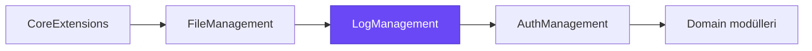
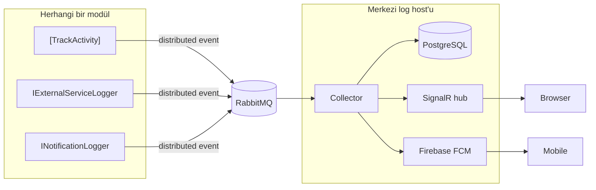
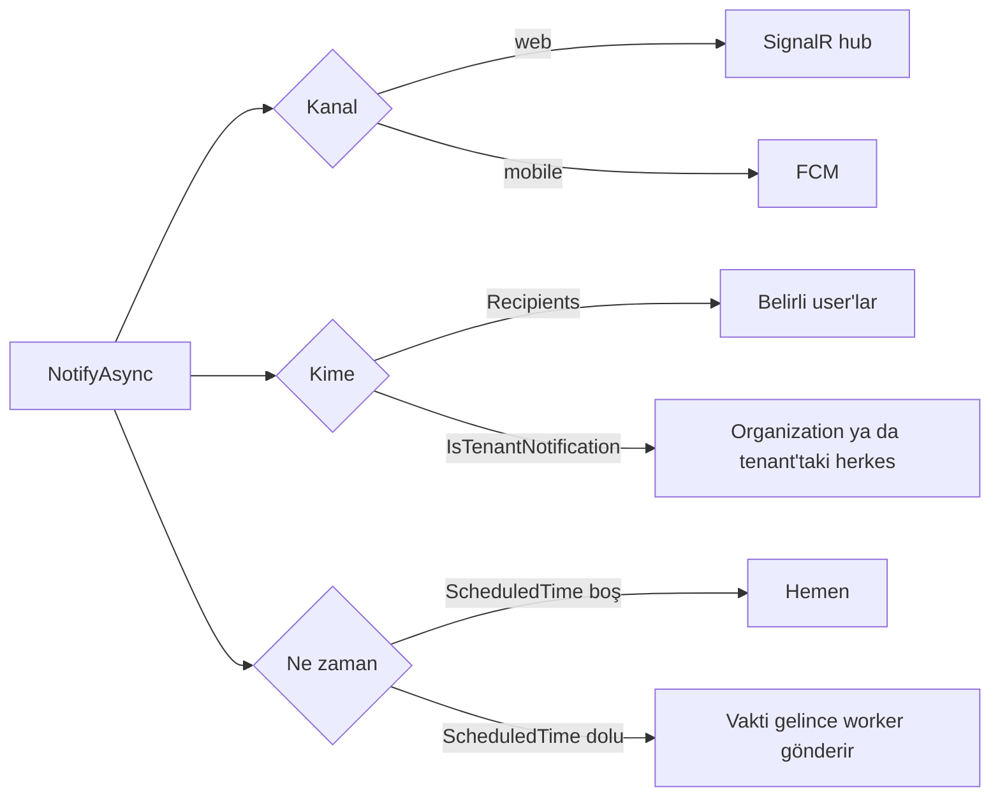

# Byd.LogManagement

Platformda "ne oldu" sorusunun tek sahibi. Activity log, audit log ve external service call kayıtlarını tutar; web ve
mobile notification gönderir, bağlı ekranlara canlı data akıtır. Bir modül kendi log tablosunu ya da push entegrasyonunu
yazmaz: ne olduğunu bildirir, log modülü kaydeder ve teslim eder.



## Capabilities

| Capability | Ne sağlar |
|---|---|
| [Activity log](#activity-log) | "Ali aracı güncelledi" gibi user işlem geçmişi, tek attribute ile |
| [External service log](#external-service-log) | Dış servis çağrılarının süresi, response'u ve hatası |
| [Notification](#notification) | Kalıcı web ve mobile bildirim; user'a, tenant'a ya da organization'a, hemen ya da ileri tarihli |
| [Live stream](#live-stream) | Araç konumu gibi anlık data'yı bağlı ekranlara itme |
| [Realtime hub](#realtime-hub) | Browser'ın bağlandığı tek SignalR hub'ı |
| [Mobile push](#mobile-push) | Tenant'a ait Firebase projeleriyle FCM push |
| [Audit log](#audit-log) | ABP request ve entity change kayıtları, database ya da Elasticsearch'e |

## Nasıl çalışır

Modüller kaydı distributed event olarak gönderir. Event'leri tüketen, tabloya yazan, notification gönderen ve hub'ı açan
taraf yalnız merkezi log host'udur. Böylece bir modül sadece "ne oldu" der; kayıt ve teslim tek yerde yapılır.



Event'leri işleyen parçalar `Byd.LogManagement.Collector` paketindedir ve yalnız merkezi host'a eklenir.

## Activity log

Controller action'ına `[TrackActivity]` yazılır; action başarıyla bitince kayıt oluşur. Kayıt işlemi yapan user'ı, işlem
türünü ve hangi kayda dokunulduğunu tutar. Mesaj metni modülün kendi localization dosyasındadır ve action'ın döndürdüğü
DTO'dan doldurulur.

```csharp
[HttpPut(VehicleEquipmentRoutes.ById)]
[TrackActivity<VehicleManagementResource>(
    VehicleManagementLocalizationKeys.ActivityLogs.VehicleEquipmentUpdated,
    ActivityKind.Updated, nameof(VehicleEquipmentDto.Id))]
public virtual async Task<Result<VehicleEquipmentDto>> UpdateAsync(...)
```

| İşlem türü | Ne zaman |
|---|---|
| `Created`, `Updated`, `Deleted` | Kayıt açıldı, değişti, silindi |
| `Uploaded`, `Downloaded` | File yüklendi, indirildi |
| `StatusChanged` | Durum değişti |

## External service log

`IExternalServiceLogger.TrackAsync` bir HTTP ya da SDK çağrısını sarar: süresini, response kodunu ve ham response'u
kaydeder; hata olursa orijinal exception'ı olduğu gibi tekrar fırlatır. Kayıt tenant, organization ve request'in
correlation id'sini taşır; bir request'in bütün dış çağrıları correlation id ile tek seferde görülür. GTFS feed indirme
ve validator, realtime feed okuma, content'in Instagram ve ffmpeg çağrıları bu kayıtla izlenir.

## Notification

Tek giriş noktası `INotificationLogger.NotifyAsync`'tir. Notification kalıcıdır, outbox ve inbox sayesinde kaybolmaz.



- Mobile'da alıcılar yerine bir topic'e de gönderilebilir.
- Notification bir iş kaydına bağlanabilir (`ExternalId`), böylece ekran tıklanınca ilgili kayda gider.
- User kendi notification'larını `notifications/my` ile okur ve okundu işaretler.
- Uzun süren işlerin (import, validation, export) sonucu client'a bu yolla itilir; client polling yapmaz.

## Live stream

`INotificationLogger.StreamAsync(ad, data)` bir organization'ın bağlı ekranlarına anlık data gönderir: araç konumu,
tahminler, pano akışı. Bilerek kalıcı değildir; database'e yazılmaz, kaçan mesajın yerini bir sonraki alır.

## Realtime hub

Browser `/signalr-hubs/log-management/notifications` adresine WebSocket ya da SSE ile bağlanır; long polling kapalıdır.
Browser bu transport'larda header gönderemediği için access token `access_token` query parametresiyle gelir.

| Mesaj | İçerik |
|---|---|
| `notificationReceived` | User'a gelen notification |
| `streamReceived` | `{ moduleName, name, payload }` |

## Mobile push

Firebase projeleri tenant başına tanımlanır; her projenin FCM service account file'ı file modülünde saklanır, repo'ya
girmez. Cihaz `mobile-tokens` ile kayıt olur: user ve proje başına tek aktif token ve cihaz dili. Her push denemesinin
sonucu (başarılı mı, hangi kod) ayrı satırda tutulur.

## Audit log

ABP'nin audit tabloları modülün kendi schema'sında (`log_management`) durur. Kaydın nereye yazılacağı
`LogManagement.AuditLogSaveMode` setting'iyle seçilir:

| Değer | Nereye |
|---|---|
| `Database` (default) | PostgreSQL |
| `Elasticsearch` | `log_management_audit_logs` index'i |
| `Both` | İkisine de, aynı id ile |

## Modülde kullanım

Template'ten üretilen modül log'u auth paketi üzerinden alır; `[TrackActivity]`, `IExternalServiceLogger` ve
`INotificationLogger` hazırdır. Collector paketi yalnız merkezi log host'una eklenir; bir modüle eklenirse her modül her
event'i işlemeye başlar.

| Permission | Ne verir |
|---|---|
| `LogManagement.ActivityLogs.View` | Activity log'u görmek |
| `LogManagement.ExternalServiceLogs.View` | External service çağrılarını görmek |
| `LogManagement.FirebaseProjects.View` / `.Manage` | Firebase projelerini görmek / yönetmek |

## Geliştirme

```bash
dotnet build Byd.LogManagement.slnx
dotnet test Byd.LogManagement.slnx
```
